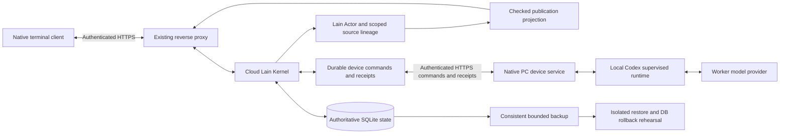

# Cloud residency and device continuity

Status: bounded implementation, deployment and deterministic acceptance delivered,
2026-11-05. The original eight-part goal is reconciled in
[cloud acceptance](CLOUD_ACCEPTANCE.md), including current operations and explicit
real-use limits. The original handoff kept an empty unconfigured cloud instance;
subsequent explicit chat activation configured DeepSeek Flash and a separate
native cloud entry, with one short real conversation verified. Personal data and
the existing local instance were not migrated. Earlier increment entries below
retain their historical scope and then-pending checks.

2026-11-05 update: twelve actual Linux–Windows Worker fixture cases now pass
through certificate-verified authenticated HTTPS. They cover native terminal
dispatch/permission denial, permission allowance and missing application evidence,
same-session follow-up, parallel chat, frontend exit/restore, Kernel/host restart,
lost native and committed HTTP receipts, partition and device revocation. Actual
fixture persistence records 20 provider threads (ten empty initialization seeds
plus ten durable work threads) and twelve accepted turns; fault recovery adds no
duplicate submissions. Native Windows temporary state and the isolated cloud
service/route/data were cleaned; the production identity/PID/binary stayed fixed.
The fixture uses no paid provider or QQ.

The selected-scope model-schema follow-up also passes seven actual HTTPS memory
cases on a separately copied, hash-checked Linux candidate. Native Windows CLI
enrollment supplies equal-path synthetic device registrations. Checked model
requests and exact retrieval receipts prove device/workspace isolation, explicit
project-only sharing, channel-ID non-disclosure and context-switch withdrawal.
Reviewed inferred memory, supersession, deletion of a fresh active source and
device expiry/revocation invalidate derived history; ConPTY checks traverse all
displayed pages and reopen without restoring withdrawn bodies. Startup metadata
cache contains no semantic body. Content-free SSE catches a snapshot/subscription
gap and an idle authority deadline. Six assertion-guard and five model-fixture
tests protect these checks. This uses 38 local fake-model calls, no paid/QQ call.
The candidate matches the 328-pass Linux source; its identical executable is now
deployed after a verified stopped backup, with unchanged identity/database/config.
The latest twelve Worker cases pass again on this executable. Final operations
inventory confirms two schema32 releases, seven bounded archives, all temporary
fixtures and their 36 operator inputs cleaned, and existing applications retained.
The full requirement/evidence handoff is recorded in the acceptance document.

## Responsibilities and deployment boundary

Kernel identity, semantic state and policy belong to the cloud. The PC owns local
execution and provider credentials. The target device link does not route every
Worker tool call through the Actor. Paid provider work is not part of deterministic
fixture acceptance. The running Kernel has now been upgraded from schema28 to32
after a verified stopped backup; no PC database or personal channel was imported.
Initial backup/isolated restore and a schema28→32→restored28 rehearsal exist;
the actual upgrade, public authenticated startup/SSE, identity-preserving restart
and post-upgrade online backup pass. Actual HTTPS structured Worker execution now
passes the bounded cases listed above; real-provider experience stays separate. See
[cloud operations](CLOUD_OPERATIONS.md) for lifecycle and rollback boundaries.

## Delivery and acceptance

The schema031 private-lineage increment adds cumulative direct/inherited private
sources, original-row fingerprints, final-completion checks and checked HTTP/SSE/
QQ publication. Full-input replacement permanently retires excluded audit speech
from frontend/model reuse. Its detailed contract is in
[ADR034](adr/034-contextual-semantic-memory.md#private-evidence-and-publication-schema031).
Client startup/live invalidation is implemented and native verified; public
transport startup/invalidation also passes after the real upgrade. Actual
two-machine Worker fixtures now pass. The cloud upgrade and later same-schema
maintenance release were separate backed-up operations, not implicit effects of
migrations. The final audit does not turn fixture results into real-provider or
QQ daily-use acceptance.

2026-11-04 native evidence for schema031: the same 218-input dirty-tree snapshot
passes Kernel274/wire6 and foundation11/memory9/profiles5/actor10/actor-reliability7
on Windows and Linux (322 each, two existing manual ignored). Windows also passes
67 terminal tests (one existing manual ignored), strict workspace/all-target
Clippy and format. Fifteen new bridge regressions cover the boundary changes;
four external-copy mutations removing taint, cumulative disclosure, QQ lineage
and audit-retirement guards fail the corresponding tests. Mutation outputs were
removed after evidence capture. Linux Clippy was not rerun for this increment;
the earlier bootstrap's explicit Rust1.89 lint exception remains separately
recorded. No running service/database upgrade or paid/QQ invocation is implied.

1. Stable project identities and explicit device/workspace mappings. Preserve
   legacy Workspace memories without mapping or disclosure promotion. Test two
   devices with equal path strings, explicit sharing, stale decisions, recovery
   and revocation.
2. Kernel-enforced contextual memory access: independent origin and visibility,
   project/device/workspace/channel isolation, corrected/withdrawn dependencies
   and history invalidation. Ordinary Actor tools must not gain new private scopes
   merely because the transport has administrator authentication.
3. Versioned bounded startup snapshots, compatible resource manifests, live
   change subscription, reconnect/resnapshot and private disposable caches. Bind
   snapshots to authority/context, close snapshot/subscription gaps, and never
   replay uncertain effects or send a retained draft automatically.
4. Actual Linux Kernel to native Windows device execution through verified HTTPS:
   structured fixtures, independent Chat/Work, exact approval stages, same-session
   continuation, cancellation, restarts, connection loss and missing receipts.
5. Generic deployment/upgrade/backup/restore/rollback/retention instructions and
   templates, a tested database rollback and truthful resource/evidence inventory.

Each item needs its own evidence. Paid models, QQ migration/collection/contact,
personal-database migration and multi-day experience remain separately scoped.
Private deployment profiles, accounts, actual domains/IPs and evidence stay
outside Git. Nothing in this document authorizes them to enter source or prompts.

## Project identity foundation

`ProjectId` is a Lain identity, not a path, repository URL, label or provider ID.
Only an explicit owner decision maps an admitted `(DeviceId, DeviceWorkspaceId)`
to a project. Mapping does not alter device registration, Worker policy, channels
or semantic-memory visibility. No path comparison across hosts or filesystem
canonicalization on the cloud is used for this mapping.

Projects have a stable ID, a bounded display name, Active/Archived state and CAS
revision. Mapping decisions have their own revision and retain an unbound
tombstone. Exact RequestId retries recover the original decision; changed payload
under the same ID conflicts. Current mapping is a separate read, so a historical
receipt cannot masquerade as current authority. Mapping checks the exact active
device revision and project revision reviewed by the owner. Device reports are
availability observations, not project or Worker authority.

The first increment implements this registry before enabling contextual Actor
memory. New memory scopes must remain inaccessible to generic Actor tools until
the trusted conversation-context and freshness checks are connected. Legacy
Workspace scope is retained; migration creates no projects, maps no paths and
changes no existing memory body, source, scope or grant.

## Registry implementation (schema 029)

The owner API currently exposes:

| Method | Path | Result |
| --- | --- | --- |
| GET / POST | `/v1/projects` | Bounded registry / creation receipt |
| GET | `/v1/projects/{id}` | Current project metadata |
| POST | `/v1/projects/{id}/change` | Exact-revision name/state change receipt |
| GET | `/v1/devices/{device}/workspaces/{workspace}/project` | Current assignment or null |
| POST | `/v1/project-workspaces` | Explicit assignment/unbinding receipt |

`CreateProject` supplies `id`, `request_id`, and a nonempty display `name` of at
most 128 UTF-8 bytes without controls. Names are not unique identities. The
registry retains at most 128 projects, including archived records; reads are
bounded and do not enumerate host directories. Project archival does not delete
memory or assignment history.

`SetProjectWorkspace` supplies `request_id`, `device_id`, `workspace_id`,
`expected_device_revision`, `expected_revision`, and either both `project_id` /
`expected_project_revision` or neither. Revision zero means no previous mapping.
Assigning requires an active unexpired device, its actual admitted workspace,
and the exact active project revision. Unbinding may reduce a revoked/expired
device's assignment if the owner reviewed its current revision. It never erases
the mapping's revision tombstone. No device report or path canonicalization is
needed or permitted as a substitute for this owner decision.

Device credentials cannot access these owner routes. The Actor tool registry has
no project-administration capability. Mapping history and current project state
are not autonomous reading grants. This first increment does **not** implement
Project/Device semantic-memory scopes by itself. The following schema030
increment connects contextual recall; startup resource synchronization and native
cross-machine acceptance remain separate. No existing private channel is opened
by registration or mapping.

Migration 029 only adds project metadata, current assignment and exact-request
receipt tables. Native tests reopen a schema28 fixture and compare its existing
memory snapshots byte for byte; no semantic migration or path auto-mapping is
performed. A schema28 binary must not be pointed at schema29 data for rollback:
the full stage still requires a tested backup/database rollback procedure.

### Registry verification

2026-11-04: seven new deterministic cases cover same names/paths/workspace IDs,
explicit sharing, exact historical retries, CAS, archival, expiry, owner-only HTTP
access and byte-preserving schema28 migration. Selected native Windows validation
passes 276 tests (two existing manual ignored), native Linux Kernel library passes
251 (two manual ignored); Windows workspace/all-target Clippy and format pass.
An isolated source-copy mutation removing device/workspace membership fails the
expected test; the maintained source stays unchanged. These results prove the
registry increment, not contextual memory, synchronization or real cross-machine
Worker behavior. Deployment/upgrade acceptance for this code is still pending.

## Contextual memory (schema030, deterministic core verified)

`GET /v1/conversations/{id}/memory-context` reads the current owner selection;
`POST` accepts `SetMemoryContext { request_id, expected_revision, selection }`.
Selection includes device_id, workspace_id and device_revision. Its optional
project includes project_id, project_revision and mapping_revision. The Kernel
checks exact active registration/mapping/project versions. Null clears selection
and retains the revision. These owner routes create no inference or work.

The new Project, Device and DeviceWorkspace memory scopes use stable IDs, not
cloud-host paths. An explicitly selected PC context admits its own device and
workspace records; project records additionally need the explicit current
assignment. Mapping two PCs to a project shares project-scoped records only,
never device-private or channel-private records. Generic model arguments cannot
select context or administer projects. Existing owner memory APIs remain the
administrative write/inspect path; model reads use a separate context-aware path.

Per-turn persisted dependency versions guard retrieval, inherited model history,
inference admission, action/candidate admission and generated-result publication.
Context-influenced preview text is held. Different context or withdrawn source
removes affected old messages/actions from later model input. Accepted derived
records check the original dependency lineage; the audit snapshot does not become
a permission to resurrect a forgotten source. Denial/interruption is still
allowed after source invalidation. No uncertain action is retried automatically.

Origin is independent of visibility. New origin values distinguish owner API,
owner-selected Actor context, channel evidence and local session summary. Missing
legacy origin remains unknown, and selecting a device does not prove a physical
collection origin. Proposals retain existing review and inferred authority; an
ordinary approval cannot promote private derived facts to a broader scope.
See [ADR034](adr/034-contextual-semantic-memory.md) for the selected boundaries.

The same dirty-tree source snapshot passes native Windows Kernel259/wire6 plus
foundation11/memory9/profiles5 (290 distinct passes, two existing manual ignored).
Native Linux Kernel259/wire6 pass (265, two manual ignored). Windows workspace /
all-target strict Clippy and format pass without exceptions. This increment did
not run Linux Clippy; the bootstrap's separately recorded Rust1.89 style exception
must not be silently generalized into a new strict pass.

Eight new core cases cover equal Windows paths, project-only explicit sharing,
device/channel non-disclosure through generic tools, exact context receipts,
revocation, corrected/deleted source lineage, context-switch history, legacy
schema29 byte preservation, held in-flight output and stale approval with working
denial/cancellation. Existing channel review tests additionally check actual
channel origin rather than inferring a PC origin. Independent source-copy
mutations removing workspace disclosure or source-version/status checks both
produce the expected assertion failures; maintained-source regressions pass.

These checks do not prove every channel-to-generic-memory information flow.
That bridge, especially inherited private evidence and late grant invalidation,
still needs explicit acceptance before the memory requirement is closed. CLI
context selection, startup/cache integration, real cross-machine execution and
database rollback are also pending. This is not a deployment or daily-use claim.
